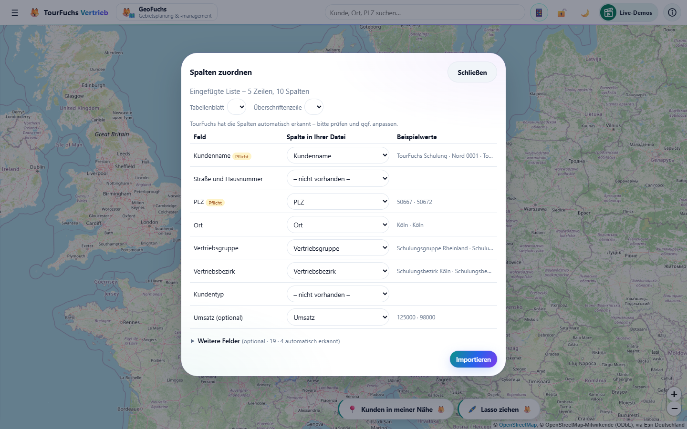
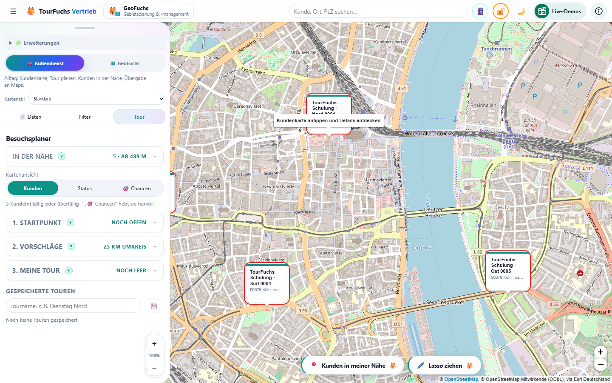
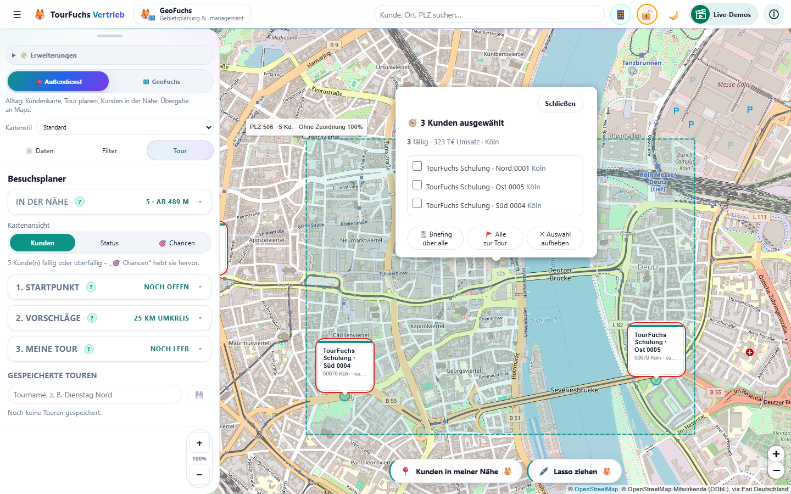
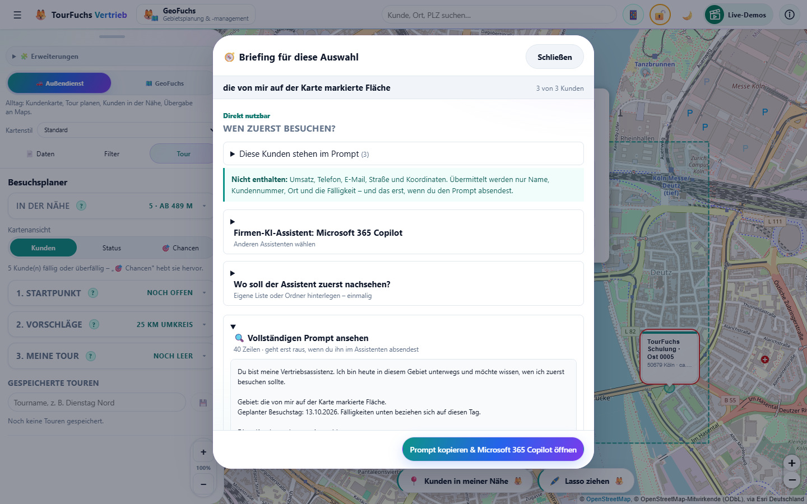
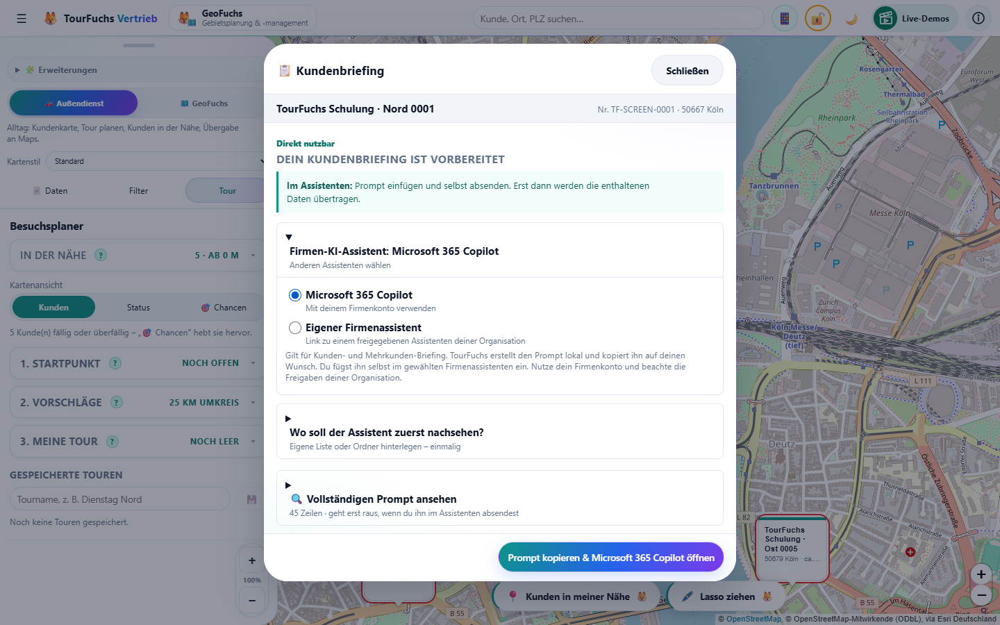
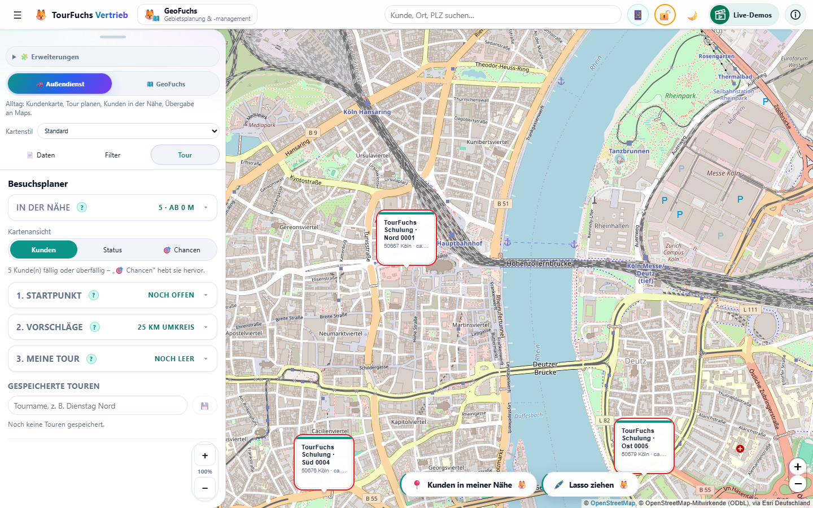
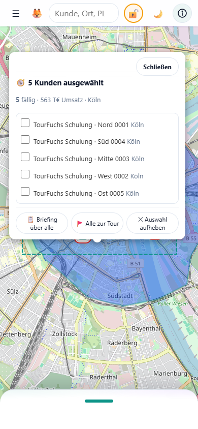
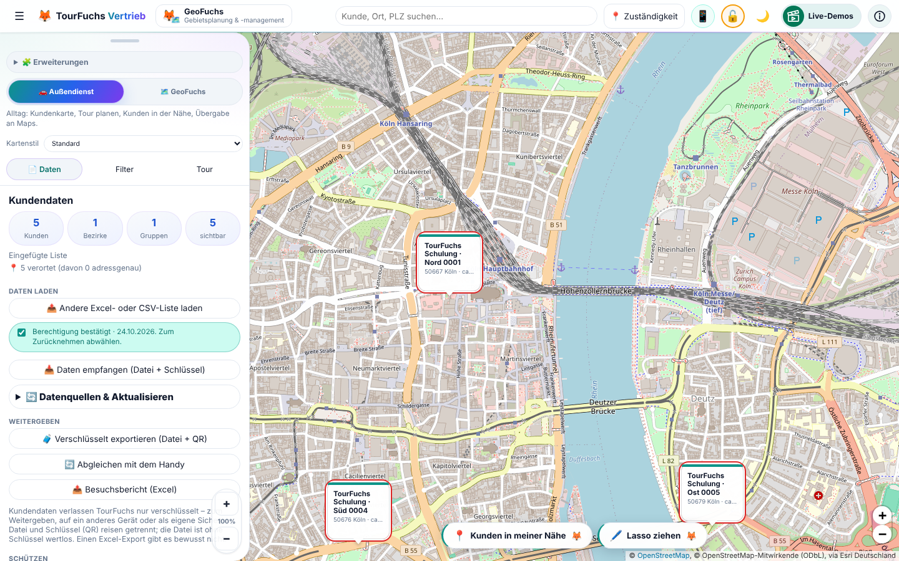

# TourFuchs Vertrieb - Kurzanleitung

Stand: 22.10.2026 · App-Version 3.7.0

## 1. App starten

TourFuchs im Browser oder als installierte PWA öffnen.

Wichtig:

- Desktop: Kundenkarte, Suche, Briefing, Tour und Daten
- Smartphone: Kundenkarte, „In der Nähe", Briefing, Tour und Navigation
- Optional am Desktop: Gebietsplanung und ServiceFuchs (Vertragsradar & Einsätze) nach Aktivierung

## 2. Daten laden

1. Tab Daten öffnen.
2. Excel-Liste hochladen.
3. Spaltenzuordnung prüfen.
4. Importieren.
5. Import-Ergebnis kontrollieren.

Pflichtfelder:

- Kundenname
- PLZ oder vorhandene Koordinaten

Der Vertriebsbezirk ist empfohlen. Ohne ihn läuft der Kunde unter „Ohne Zuordnung".

*BILD-IMPORT-03 - Zuordnungen und Beispielwerte prüfen, dann „Importieren".*

## 3. Karte nutzen

- Suche oben für Kunde, Ort, PLZ oder Kundennummer. Kundentreffer zeigen `[Kundennummer] Kundenname`, darunter PLZ, Ort und gegebenenfalls VB. Führende Nullen bleiben in der Anzeige erhalten; ohne Nummer steht nur der Name.
- Marker anklicken, um Kundendetails und einen vorhandenen VB-Namen zu sehen. **Nr. …** kopiert die Originalnummer (000123); **Name + Nr.** kopiert `Kundenname [123]` mit Nullenkürzung in der Klammer.
- Kartenstil wechseln: Hell, Standard oder Satellit.
- Bezirkszuordnung und Bezirksfarben als Orientierung nutzen.
- Im Tab **Filter** bei Bedarf **"Umsatz von-bis"** aktivieren. Ohne gültigen
  Umsatzwert wird ein Kunde dann ausgeblendet; `0 EUR` ist ein eigener Wert.
- Strategische Flächenwerkzeuge nur bei aktiviertem Modul verwenden.

### Live-Demos steuern

Während einer Live-Demo steht oben eine Steuerleiste:

- **Tacho „1,2×"**: Tempo wählen (1,2× · 1,0× · 0,8× · 0,6×) – die Musik läuft
  unverändert weiter.
- **↺ Zurück**: vorige Erklärung noch einmal zeigen.
- **⏭ Weiter**: Schritt für Schritt – bis zur nächsten Erklärung, dort anhalten.
  Ideal, um die App live vorzuführen und dabei zu erzählen.
- **▶**: wieder normal durchlaufen lassen. **✕**: beenden.

Für Präsentationen ohne App gibt es jede Live-Demo auch als Video (Desktop im
Monitor-, Handy im Smartphone-Rahmen).

## 4. Lasso und Mehrkunden-Briefing

> Eine Geste um eine reale Region wird zur Auswahl mehrerer Kunden; TourFuchs
> erstellt daraus ein strukturiertes Mehrkunden-Briefing für den internen
> KI-Assistenten des Nutzers.

*BILD-LASSO-01 - Auf der Karte „Lasso ziehen" wählen.*

1. `Karte -> „Lasso ziehen"`.
2. Fläche mit Finger oder Maus umfahren und loslassen.
3. Treffer in der Auswahlkarte prüfen.
4. **„Briefing über alle"** wählen.
5. Im Mehrkunden-Briefing den vollständigen Prompt prüfen.
6. Prompt kopieren und Assistent öffnen; dort selbst einfügen, prüfen und senden.

*BILD-LASSO-04 - Das Lasso erzeugt nur die Auswahl; erst dieser Knopf öffnet die Prompt-Vorbereitung.*

*BILD-LASSO-05 - Der Prompt entsteht lokal im Briefing und ist vor dem Kopieren lesbar.*

Wichtig:

- „Briefing über alle" erscheint ab mindestens zwei echten Kunden.
- Bei einem Kunden dessen Marker öffnen und „Briefing" wählen.
- Für reine Demo-Kunden gibt es keinen echten Prompt und keinen Assistenten-Start.
- Ein Popup-Blocker kann das Öffnen verhindern; der Prompt kann trotzdem in der Zwischenablage liegen.

## 4a. Zielassistent wählen

Microsoft 365 Copilot ist voreingestellt. „Firmen-KI-Assistent: … · Anderen Assistenten wählen“ steht ohne Moduswechsel zur Verfügung; die lokal gemerkte Wahl gilt auch für das Mehrkunden-Briefing. Basis/Profi gibt es seit 26.09.2026 nicht mehr.

*BILD-LASSO-08 - Microsoft 365 Copilot oder Eigener Firmenassistent mit HTTPS-Link; TourFuchs sendet nichts selbst.*

## 5. Gebiets-Cockpit

Voraussetzung: Desktop und aktiviertes Modul.

1. `🧩 Erweiterungen` öffnen.
2. `GeoFuchs (Gebietsplanung & -management)` aktivieren.
3. Modus Gebietsplanung wählen.
4. Tab Gebiete öffnen.
5. Gebiets-Cockpit öffnen.
4. KPI-Karten lesen:
   - Status
   - Top-Bezirk
   - Schwächster Bezirk
5. Tabelle lesen:
   - Standard: Top & Flop 3
   - Balken: relative Stärke zum stärksten sichtbaren Wert
   - Alle anzeigen: vollständige Liste

## 6. Was-wäre-wenn-Simulation

Diese Spezialfunktion gehört zum aktivierten Modul `GeoFuchs (Gebietsplanung & -management)`.

1. Ebene wählen, zum Beispiel Landkreise.
2. Gebiet suchen oder auswählen.
3. Ziel-Bezirk wählen.
4. Auswahl zuweisen.
5. Ergebnis prüfen.
6. Entweder Zuweisung übernehmen oder Simulation zurücksetzen.

Merksatz:

> Erst Zuweisung übernehmen schreibt dauerhaft.

Zur Orientierung: Die gewählte Gebietsebene bestimmt die Flächen, zum Beispiel
Landkreise. Farbe und Kürzel zeigen Vertriebsbezirk oder Vertriebsgruppe. Ein
Filter blendet unpassende Flächen und Beschriftungen vollständig aus; bei nur
einem gewählten Vertriebsbezirk bleibt deshalb genau dessen Ausschnitt stehen.
Mit **"Gebietsflächen ausblenden"** lässt sich ganz auf die Kundenkarte wechseln.
Mit **"Fläche einfärben ab"** bleiben Landkreise oder PLZ-Flächen unter einer
frei wählbaren Mindestzahl sichtbarer Kunden neutral; `0` schaltet die Schwelle aus.
Ein Klick auf eine kleine Bezirks-/Gruppenkachel öffnet die große Detailkarte mit
Kunden, Umsatz, Durchschnitt, Teilgebieten und stärksten Standorten. **"Gebiet auf
Karte zeigen"** zoomt anschließend auf die vollständige räumliche Ausdehnung.

## 7. Tour planen

Der Tourplaner öffnet zuerst als Übersicht: die drei Schritte **Startpunkt ·
Vorschläge · Meine Tour** eingeklappt. Ein Tipp auf einen Schritt zoomt hinein
(volle Fläche), „☰ Übersicht" führt zurück – auf Handy wie Desktop.

1. Außendienst öffnen (Standardzustand).
2. Am Desktop Tab Tour öffnen. Unterwegs (Handy, Tablet hochkant) entfällt dieser Schritt:
   Dort ist die Tour der einzige Bereich – Blatt aufziehen genügt.
3. Startpunkt setzen. (Geplant wird über **alle Vertriebsbezirke** – nur wer
   einschränken will, tippt auf die Zeile „🗺️ Bezirk: Alle Bezirke · ändern ▸".)
4. Kunden im Umkreis oder entlang der Tour anzeigen.
5. Kunden zur Tour hinzufügen.
6. „⚡ Optimieren“ wählen (ab zwei Stopps).
7. Direkt daneben „🗺️ Tour anzeigen“ wählen; erneutes Anzeigen behält den Linienmodus bei.
8. „In Google Maps navigieren“ ist die Hauptaktion. QR, Druck, Kalender, Text und Rückblick stehen unter „Teilen & Exportieren“.

Luftlinie/Straßenroute wird nur mit dem separaten Karten-Umschalter gewechselt; Straßenrouting benötigt Zustimmung.

*BILD-TOUR-01 - Tourplanung erfolgt bewusst in drei Schritten.*

## 8. Mobile Nutzung

Auf dem Smartphone stehen Karte und Tour im Mittelpunkt.

- Bottom Sheet hochziehen oder minimieren; „Tour" zieht das Blatt ganz auf.
- Kunden antippen, um Details zu sehen.
- Tour zusammenstellen und navigieren.
- Die Tour ist ein Akkordeon aus **Startpunkt · Vorschläge · Meine Tour** –
  genau eine Gruppe ist offen und folgt dem Arbeitsfluss.
- Ein kleiner schwebender **Fuchs-Knopf** schlägt den nächsten Schritt vor:
  📍 Kunden in der Nähe → 🚩 Tour ab hier planen → 🗺️ Route auf die Karte.
- In **Meine Tour** sind die Stopps kompakte Ein-Zeilen-Karten mit grüner
  Tourlinie; Reihenfolge per **Halten & Ziehen** ändern.
- Eine eingeblendete Android/iOS-**System-Navigationsleiste** verdeckt das Blatt
  nicht mehr – Hinweise und Bedienelemente liegen darüber.
- **📤 Besuche weitergeben** (in „Meine Tour" und im Feierabend-Rückblick):
  die unterwegs abgehakten Besuche als kleine Excel-Datei übers Teilen-Menü
  (Mail, Teams, OneDrive) – fürs CRM, eine KI oder den Desktop. Am Desktop die
  Datei über „Eigene Daten laden" öffnen: TourFuchs trägt nur die Besuche nach.

**GeoFuchs** (Gebietsplanung & -management) und **ServiceFuchs**
(Serviceverträge & Einsatzplanung) sind Erweiterungen. GeoFuchs ist
standardmäßig eingeschaltet, ServiceFuchs zunächst aus. Beide werden am Desktop
unter **🧩 Erweiterungen** einzeln ein- oder ausgeschaltet und stehen dann als
Kärtchen neben „TourFuchs Vertrieb" in der Kopfzeile. Am Handy gibt es sie nicht.

Karte, Kunden, Briefing und Tour bleiben der normale Außendienst-Ablauf. Komplexe
Gebietsplanung bitte am Desktop durchführen.

*BILD-LASSO-MOBIL-03 - Lasso und „Briefing über alle" funktionieren auch in der Smartphone-Kartenansicht.*

## 9. Warum die Oberfläche „aufräumt"

TourFuchs hält die Arbeitsfläche bewusst frei. Zwei Dinge, die auffallen und
kein Fehler sind:

- **Langes startet zugeklappt.** Der vollständige Briefing-Prompt, „Weitere
  Felder" bei der Spaltenzuordnung, der Datentresor: Die Kopfzeile sagt, was
  drinsteckt, ein Klick zoomt hinein. Nichts ist weg – nur einen Klick entfernt.
- **Angebote treten beim Arbeiten zurück.** Sobald Sie im Panel nach unten
  scrollen, weichen Kartenstil-Wähler und Beispieldaten-Streifen, und die
  „Erste Schritte"-Checkliste schrumpft auf eine Zeile. Wieder hochscrollen holt
  sie zurück, ein Tab- oder Moduswechsel ebenfalls; die Checkliste kommt mit
  einem Klick auf die Zeile zurück.

Auf Tabs mit wenig Inhalt bleibt alles stehen – dort wäre nichts gewonnen.

## 9a. Sprache und Schutz

- `ⓘ Info -> 🌐 Sprache`: Automatisch, Deutsch, Englisch, Französisch oder Spanisch. Die Auswahl bleibt lokal; nicht unterstützte Gerätesprachen fallen auf Deutsch zurück.
- Der Datentresor ist freiwillig, auch nach dem Entschlüsseln einer .tfsafe-Datei. Ein vorhandener Tresor wird weiterverwendet. Transportverschlüsselung und lokale Speicherung sind getrennte Schutzentscheidungen.
- TourFuchs ist ein persönliches Außendienst-Cockpit; es stellt Führungskräften keinen automatischen Zugriff auf Touren, GPS oder Besuchshistorien bereit.

## 10. Datenschutz

- Kundendaten bleiben lokal im Browser. Anonyme Seitenaufrufe werden seit 03.10.2026 gezählt; keine eigenen Bedienereignisse oder Kundendaten.
- OSM-Geocoding sendet nur Adresse, PLZ und Ort.
- Straßenrouting über OSRM erhält nach Zustimmung nur Koordinaten.
- Google Maps erhält Daten erst bei bewusster Übergabe.
- Beim Briefing erzeugt und kopiert TourFuchs den Prompt lokal. Übertragen wird
  er erst, wenn der Nutzer ihn im Assistenten selbst einfügt und absendet.
- Vor Daten löschen bei Bedarf eine verschlüsselte Sicherung anlegen
  („Verschlüsselt exportieren (Datei + QR)"). Einen Excel-Export gibt es
  bewusst nicht: Excel geht nur hinein, Kundendaten gehen nur verschlüsselt
  heraus.

*BILD-DATEN-01 - Vor „Andere Excel- oder CSV-Liste laden" oder „Daten löschen" bei Bedarf verschlüsselt sichern.*

## 11. Häufige Probleme

### Keine Kunden sichtbar

- Filter prüfen.
- Bezirk prüfen.
- PLZ-Spalte prüfen.
- Karte herauszoomen.

### Keine Tourvorschläge

- Startpunkt setzen.
- Radius erhöhen.
- Bezirk prüfen.

### Alter PWA-Name

- Alte PWA entfernen.
- Seite neu laden.
- App neu installieren.

### Umfangreiche Excel-/CSV-Dateien einlesen

Nach der Dateiauswahl zeigt TourFuchs „Datei wird vorbereitet“ mit Dateiname und Verarbeitungsschritt. Große Listen können eine Weile dauern; sie werden lokal im Hintergrund eingelesen. „Abbrechen“ oder Escape führt zurück, ohne den bisherigen Kundenbestand zu ändern. Danach öffnet sich „Spalten zuordnen“. Auch beim Wechsel von Tabellenblatt oder Überschriftenzeile erscheint der Wartedialog. Bei einem Lesefehler lässt sich die Auswahl wiederholen.

### Mehr Platz im Desktop-Panel

Den rechten Rand des Panels mit der Maus ziehen: 340 bis 600 Pixel, maximal 150 % der Standardbreite von 400 Pixeln. Die Breite wird lokal gespeichert und nach dem Neuladen wiederhergestellt. Das funktioniert auch bei frei verschobenem Panel.

### Ruhiger Start und Kunden-Kopie (13.10.2026)

Bei Beispieldaten bleibt das Desktop-Panel zunächst geschlossen. „Verstanden – erst umsehen“ öffnet es; während und nach der Live-Demo steht es automatisch zur Verfügung. „Eigene Daten laden“ öffnet zuerst den Importdialog und nach erfolgreicher Übernahme das Panel. Bereits gespeicherte eigene Daten starten mit sichtbarem Desktop-Panel.

In der Kundenkarte kopiert **Nr. …** nur die Originalnummer einschließlich führender Nullen. **Name + Nr.** kopiert `Kundenname [Kundennummer]`, z. B. `Musterkunde GmbH [123]`, mit der bisherigen Nullenkürzung in den Klammern.

Auf dem Smartphone bietet „Planungsbereich“ durchsuchbare Mehrfachfilter über die am Desktop aktivierten Kategorien und eine dezente Kartenfärbung. Tourstopps außerhalb des Filters bleiben erhalten. „↺ Tour leeren“ beendet die Tour und kehrt zur normalen Karte mit den weiterhin gesetzten Filtern zurück.

## Ergänzungen vom 13.10.2026 (Guide 3.24)

- Desktop: „Live-Demos“ mit grünem Filmsymbol steht dauerhaft oben rechts und öffnet die Übersicht der verfügbaren Geschichten; am Handy bleibt der Info-Zugang.
- „Verschlüsselte Kundendaten übernehmen“ ist am Desktop und Handy verfügbar: Ein Kollege importiert Excel und ordnet Felder einmal zu, exportiert unter „Sicherer Umzug“ und gibt die .tfsafe-Datei sowie den Schlüssel getrennt weiter. Die Empfänger müssen keine Felder mehr zuordnen. Die Demo entschlüsselt echte Beispieldaten in einer isolierten Vorschau; der eigene Bestand bleibt erhalten. Der lokale PIN-Tresor bleibt freiwillig.
- Die Briefing-Demos zeigen die Auswahl des KI-Partners, den vollständigen angepassten Prompt und die lokale Kopieraktion. Die gespeicherte KI-Wahl bleibt erhalten; in der Vorführung wird kein Assistent geöffnet.

## Firmen-KI und aktueller Import (Guide 3.24, 13.10.2026)

- Im Kunden- und Mehrkunden-Briefing heißt die Auswahl **„Firmen-KI-Assistent“**. **Microsoft 365 Copilot** ist voreingestellt. Alternativ bietet **„Eigener Firmenassistent“** das Feld **„Adresse des Firmenassistenten“** für einen freigegebenen HTTPS-Link der eigenen Organisation. Die Wahl wird lokal gespeichert und gilt für beide Briefings. Alte entfernte Anbieter-Auswahlen fallen auf Copilot zurück; eigene Links bleiben erhalten.
- Nutze dein Firmenkonto und beachte die Freigaben deiner Organisation. TourFuchs prüft diese nicht. Es baut den Prompt lokal, zeigt ihn vor dem Kopieren und öffnet auf Klick den gewählten Assistenten. Du fügst den Text selbst ein und sendest ihn dort ab. Die Live-Demos zeigen beide Optionen, den vollständigen Copilot-Prompt und die lokale Kopie, ohne einen Assistenten zu öffnen.
- Verschlüsselter Empfang: **1 Datendatei auswählen**, dann **2 Schlüssel laden** über **„Schlüsseldatei auswählen (.txt)“**, danach **„Entschlüsseln und importieren“**. QR und Schlüsseltext bleiben Alternativen. Beim Export steht **„Schlüsseldatei herunterladen (.txt)“** bereit; Datei und Schlüssel getrennt weitergeben. Bisherige `.tfsafe`-Dateien funktionieren mit ihrem ursprünglichen Schlüssel weiter.
- Mobil liegt der Griff bei eigenen Daten 32 px höher und bietet mindestens 44 px Touchfläche. Farbige Flächen bleiben beim Herauszoomen auf dreistelligen PLZ-Gebieten.

## Zuständigkeit für Neukunden finden (22.10.2026)

Oben neben der Suche **📍 Zuständigkeit** wählen. Ab drei PLZ-Ziffern erscheint
die Übersicht; vier oder fünf Ziffern grenzen sie weiter ein. Sie zeigt VBZ,
Account Manager, Kundenzahl und Umsatz des gesamten geladenen Bestands im
PLZ-Bereich. Kartenfilter spielen dabei keine Rolle. Bestandsverteilung ist
keine verbindliche Neukundenzuordnung: bei mehreren Bezirken Rücksprache halten.
Telefon und Teams sind anklickbar, wenn Mitarbeiterkontaktdaten hinterlegt
sind. **Zuordnung kopieren** übernimmt die Angaben in die Zwischenablage.

**↗ DUVE** erscheint automatisch direkt neben **↗ SieSales**, ausschließlich
bei eigenen Kunden mit gültigem SieSales-Link und Kundennummer. Kein vorheriges
Einrichten nötig. Erst der Klick öffnet die Suche mit der Kundennummer;
Firmenkonto/Berechtigung erforderlich. Unter **Firmenlink in der Kundenkachel
einrichten** lässt sich der Link ändern oder mit **Firmenlink entfernen**
ausblenden. Diese Einstellung gilt nur für diesen Browser.

Die Auskunft zeigt zusätzlich die **Vertriebsgruppe** und die **Häufigste
Kundenart im VBZ**, aus dem importierten **Kundentyp** abgeleitet. Grundlage ist
der gesamte geladene Bestand desselben VBZ und derselben Vertriebsgruppe,
auch außerhalb der gesuchten PLZ und unabhängig vom Account Manager. Anzahl
und Anteil sind sichtbar; Gleichstände und fehlende Typen werden benannt.
Firmenkürzel werden nicht fest interpretiert. Details: KI-Guide, Kapitel 26.

### Kundennummer in die Zwischenablage

In der Kundenkachel stehen zwei eindeutige Knöpfe nebeneinander:
**⧉ Nr. …** kopiert ausschließlich die angezeigte Nummer, einschließlich
führender Nullen, ohne Klammern. **⧉ Name + Nr.** kopiert
`Kundenname [Kundennummer]` mit der bisherigen Nullenkürzung in den Klammern.
